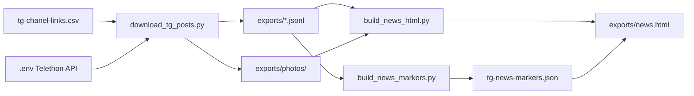

# TG Air Alerts

Інструмент для збору, перегляду та первинного аналізу повідомлень із Telegram-каналів про повітряні тривоги, обстріли та пов’язані події в Україні.

Проєкт об’єднує кілька джерел (моніторингові канали, медіа, OSINT) в одну хронологічну стрічку, а потім дозволяє швидко знаходити в текстах згадки локацій, зброї, військової техніки та інших важливих сутностей.

## Ідея

Під час масованих атак інформація розкидана по десятках Telegram-каналів і приходить хвилями: тривоги, пуски, напрямки, збиття, уточнення по районах. Вручну відстежити всі згадки важко.

**TG Air Alerts** вирішує це так:

1. **Збирає** пости з обраних каналів за конкретний часовий інтервал.
2. **Показує** їх у зручній локальній HTML-стрічці (хронологія, фото, метадані).
3. **Підсвічує** в текстах сутності за словником маркерів — для швидкого огляду патернів без читання кожного поста окремо.

Розмітка — це не анотація кожного повідомлення, а **словник пошукових патернів** (`text` + `category`). Один маркер на кшталт `ракет` або `Київ` автоматично підсвічує всі збіги у всіх постах.

## Архітектура



| Етап | Скрипт | Результат |
|------|--------|-----------|
| Експорт | `download_tg_posts.py` | JSONL з постами + фото |
| Перегляд | `build_news_html.py` | `exports/news.html` |
| Розмітка | `build_news_markers.py` | `tg-news-markers.json` |

Детальні правила ручної розмітки — у [`MARKUP_GUIDE.md`](MARKUP_GUIDE.md).

## Структура репозиторію

```
tg-air-alerts/
├── download_tg_posts.py    # експорт постів з Telegram
├── build_news_html.py      # генерація HTML-стрічки + UI маркерів
├── build_news_markers.py   # автогенерація словника маркерів
├── tg-chanel-links.csv     # список каналів зі ставленням до війни (CSV: url,stance)
├── tg-news-markers.json    # словник маркерів для підсвітки
├── MARKUP_GUIDE.md         # інструкція з розмітки (категорії Q/W/E/R)
├── .env.example            # шаблон конфігурації API
├── requirements.txt
└── exports/
    ├── tg_posts_*.jsonl    # сирі дані постів
    ├── news.html           # сторінка для перегляду
    ├── markers_report.txt  # звіт валідації маркерів
    └── photos/             # зображення з постів
```

## Формат даних

Кожен рядок у JSONL — один пост:

```json
{
  "channel": "example_channel",
  "channel_url": "https://t.me/example_channel",
  "message_id": 12345,
  "date_utc": "2026-07-01T22:51:14+00:00",
  "date_kyiv": "2026-07-02T01:51:14+03:00",
  "text": "…",
  "views": 25,
  "forwards": 0,
  "replies": 0,
  "post_author": null,
  "grouped_id": null,
  "has_media": false,
  "photo_path": "exports/photos/example_channel/12345.jpg"
}
```

Пости в HTML сортуються за `date_kyiv` (від ранніх до пізніх).

## Система маркерів

### Категорії

| Клавіша | Категорія | JSON `category` | Що позначає |
|---------|-----------|-----------------|-------------|
| Q | Локації | `location` | міста, області, напрямки, країни |
| W | Зброя | `weapon` | ракети, БПЛА, боєприпаси |
| E | Військова техніка | `equipment` | літаки, пускові, комплекси |
| R | Інше | `other` | тривоги, пуски, загрози, удари |

### Принцип коренів

Маркер — це часто **корінь слова**, а не повна форма: `ракет` покриває «ракета», «ракети», «ракетами»; `Київ` і `Киев` — окремі маркери для UA/RU написань.

Не дублюють одне одного форми на кшталт `Бровар` + `Бровары`: коротший корінь уже покриває довший.

### Автогенерація (`build_news_markers.py`)

Скрипт за один прохід по JSONL:

- бере seed-маркери та кураторський словник;
- виявляє технічні патерни (`Ту-95`, `Х-101` тощо);
- відкидає маркери без збігів у корпусі;
- прибирає занадто широкі та дубльовані форми (коли коротший корінь уже покриває довший);
- записує звіт у `exports/markers_report.txt`.

### UI у браузері (`exports/news.html`)

- виділіть текст у пості → натисніть `Q` / `W` / `E` / `R`;
- маркери зберігаються в `localStorage`;
- **Експорт тегів** — завантажити `tg-news-markers.json`;
- **Імпорт тегів** — завантажити готовий словник для перегляду підсвіток.

Підсвітка працює через substring-match з нормалізацією (`uk-UA` lower + `ё→е`).

## Технічний стек

| Компонент | Технологія |
|-----------|------------|
| Мова | Python 3.11+ |
| Telegram API | [Telethon](https://github.com/LonamiWebs/Telethon) |
| Конфігурація | `python-dotenv` |
| Перегляд | статичний HTML + vanilla JavaScript |
| Зберігання маркерів у браузері | `localStorage` |

Залежності — у [`requirements.txt`](requirements.txt).

## Швидкий старт

```powershell
python -m venv .venv
.\.venv\Scripts\Activate.ps1
pip install -r requirements.txt
Copy-Item .env.example .env
```

Заповніть у `.env` значення `api_id`, `api_hash` і, за потреби, `phone` або `bot_token` (отримати ключі: [my.telegram.org](https://my.telegram.org/)).

### 1. Експорт постів

Додайте канали в `tg-chanel-links.csv` (у форматі `url,stance`, де `stance` — емодзі 🇺🇦 або 🐖), потім:

```powershell
python download_tg_posts.py
```

### 2. HTML-стрічка

```powershell
python build_news_html.py
```

Відкрийте `exports/news.html` у браузері.

### 3. Маркери (опційно)

```powershell
python build_news_markers.py
python build_news_html.py
```

У браузері: **Імпорт тегів** → виберіть `tg-news-markers.json`.

## Налаштування періоду експорту

Проміжок часу задається в `download_tg_posts.py`:

- `START_KYIV` — початок (київський час);
- `END_KYIV` — кінець;
- `OUTPUT_PATH` — ім’я JSONL-файлу.

Якщо змінюєте назву JSONL, оновіть `INPUT_PATH` у `build_news_html.py` і `build_news_markers.py`.

## Безпека

Не комітьте в git:

- `.env` з API-ключами;
- файли сесії Telethon (`telegram_export.session*`);
- приватні дані, якщо вони потрапляють у експорт.

Перед push перевіряйте `git status`.

## Типовий сценарій дослідження

1. Обрати ніч/ранок масованої атаки → задати інтервал у `download_tg_posts.py`.
2. Зібрати пости з усіх релевантних каналів.
3. Відкрити хронологічну стрічку в `news.html`.
4. Згенерувати або доповнити `tg-news-markers.json`.
5. Імпортувати маркери й візуально перевірити підсвітки.
6. За потреби дорозмітити вручну в браузері та експортувати оновлений словник.

## Обмеження

- Підсвітка — простий пошук підрядка, без морфологічного аналізу чи NER.
- Короткі корені можуть давати хибні збіги — словник потребує ручної перевірки.
- Експорт потребує авторизованої Telegram-сесії та доступу до каналів.
- HTML-файл великий при тисячах постів; для дуже довгих періодів варто думати про розбиття за датами.
