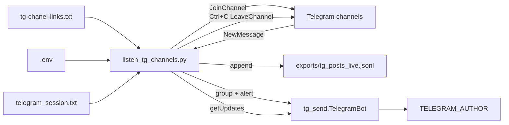

# Live listener

Режим реального часу: слухаємо Telegram-канали з `tg-chanel-links.txt`, пересилаємо нові пости автору через бота, паралельно пишемо jsonl.

## Швидкий старт

```bat
run_listener.bat
```

Повне прибирання (зупинка процесів + відписка від каналів):

```bat
cleanup_listener.bat
```

## Архітектура



| Компонент | Роль |
|-----------|------|
| **Telethon** (user-акаунт) | читає канали, отримує `NewMessage` |
| **Bot API** (`TG_BOT_TOKEN`) | надсилає DM автору (`TELEGRAM_AUTHOR`) |
| **jsonl** | сирі пости (`exports/tg_posts_live.jsonl`) — звичайний текст, не база даних |
| **`telegram_session.txt`** | сесія логіну Telethon — один рядок тексту, не SQLite |

## Файли

| Файл | Призначення |
|------|-------------|
| `listen_tg_channels.py` | live listener + групування + алерти |
| `tg_live_events.py` | інкрементальне групування подій |
| `tg_bot_handlers.py` | рейтинг, `/toggle`, стан listener |
| `cleanup_listener.py` / `.bat` | зупинка процесів + відписка + очистка lock |
| `migrate_telegram_session.py` | одноразова міграція зі старого SQLite |
| `run_listener.bat` | cleanup → listener |
| `stop_listener.py` | alias для `cleanup_listener.py` |
| `tg_telethon_io.py` | Telethon: config, канали, сесія |
| `telegram_session.txt` | сесія (не комітити) |

## Передумови

1. `.env`: `api_id`, `api_hash`, `phone`, `TG_BOT_TOKEN`, `TELEGRAM_AUTHOR`
2. Написати боту **`/start`**
3. `tg-chanel-links.txt` — по одному `https://t.me/...` на рядок
4. Сесія: `telegram_session.txt` (див. міграцію нижче)

## Сесія Telethon: текст замість SQLite

Раніше Telethon зберігав логін у **`telegram_export.session`** — це SQLite-файл. Він **не стосується наших постів** (пости йдуть у jsonl). Це внутрішній формат бібліотеки для ключів авторизації.

SQLite давав постійні **`database is locked`**: один writer на файл, а у нас одночасно listener, cleanup, reconnect Telethon, інколи завислий процес у фоні.

**Рішення:** `telegram_session.txt` — `StringSession`, звичайний текстовий файл без блокувань.

### Міграція (один раз)

Якщо є старий `telegram_export.session`:

```powershell
python migrate_telegram_session.py
```

Після успіху можна вручну видалити `telegram_export.session*`.

---

## Проблеми, з якими зіткнулись, і як вирішено

### 1. `database is locked` при старті або cleanup

**Симптом:**
```
sqlite3.OperationalError: database is locked
[warn] Session database locked (1/5), retrying...
```

**Причини:**
- Завислий `listen_tg_channels.py` у фоні тримав `telegram_export.session`
- Два процеси намагались відкрити ту саму SQLite-сесію
- Примусове закриття термінала (`Terminate batch job (Y/N)?` → **Y**) не відпускало файл одразу

**Рішення:**
- Перейти на `telegram_session.txt` (StringSession)
- `cleanup_listener.bat` — зупиняє процеси перед будь-якою операцією
- Не запускати `listen_tg_channels.py` і `download_tg_posts.py` паралельно на старій SQLite-сесії

---

### 2. `database is locked` під час обробки постів

**Симптом:** помилка в `get_chat()` / `process_entities`, reconnect, знову lock.

**Причини:**
- Паралельна обробка кількох `NewMessage` — одночасний запис у SQLite entities
- `time.sleep()` і синхронна відправка ботом **блокували asyncio event loop**

**Рішення:**
- Кеш каналів при старті — без зайвого `get_chat()` на кожен пост
- `asyncio.Lock` — пости обробляються по одному
- `asyncio.to_thread()` для відправки ботом
- `asyncio.sleep()` замість `time.sleep()`

---

### 3. Канали не зникали з підписок після зупинки

**Симптом:** після зупинки listener канали лишались у «Мої канали».

**Причини:**
- `Terminate batch job (Y/N)?` → **Y** — Python не встигав виконати `LeaveChannelRequest`
- Раніше leave працював лише для каналів, куди join відбувся в цій сесії (`Already in` — без leave)
- `cleanup` не знаходив завислий процес (був баг у пошуку PID через PowerShell)

**Рішення:**
- При shutdown listener відписується від **усіх** каналів зі списку
- `cleanup_listener.py` — окремий надійний сценарій: kill → clean lock → leave all
- Пошук процесів через `Get-CimInstance` + `-match 'listen_tg_channels'`
- Зупинка: **Ctrl+C один раз**, дочекатись `Left https://t.me/...`; не тиснути **Y**

---

### 4. `cleanup` казав «no active listener», але процес був

**Симптом:** listener працював (pid у диспетчері), cleanup його не бачив.

**Причина:** PowerShell `-like '*listen_tg_channels.py*'` інколи не знаходив процес з коротким command line.

**Рішення:** `-match 'listen_tg_channels'` + `wmic`/CIM fallback у `find_python_listener_pids()`.

---

### 5. `cleanup` падав на `PermissionError` при видаленні session

**Симптом:**
```
PermissionError: ... telegram_export.session ... used by another process
```

**Причина:** скрипт намагався видалити SQLite-файл, поки його тримав listener.

**Рішення:** не видаляти `.session` під час cleanup — лише lock-файл і `-journal`/`-wal`/`-shm` якщо вільні. Основний фікс — StringSession.

---

### 6. Два listener одночасно

**Симптом:** lock, розсинхрон, дубль повідомлень.

**Рішення:**
- `exports/listen_tg_channels.lock` з PID
- `run_listener.bat` завжди робить cleanup перед стартом
- Один listener на машину

---

### 7. Бот не надсилає DM

**Перевірити:**
- `/start` у боті
- `TELEGRAM_AUTHOR` у `.env`
- не запущений `tg_bot_debug.py` на тому ж `TG_BOT_TOKEN` (конфлікт `getUpdates`)

---

## Запуск і зупинка

| Дія | Команда |
|-----|---------|
| Старт | `run_listener.bat` |
| Зупинка | **Ctrl+C** у вікні listener |
| Якщо щось зависло | `cleanup_listener.bat` |
| Міграція сесії | `python migrate_telegram_session.py` |

## Поведінка listener

1. Join у публічні канали зі списку (auto-join)
2. `NewMessage` → завжди в jsonl
3. Пост класифікується (`tg_live_events.LiveEventEngine`):
   - **summary** (3+ location-маркери) → одразу `send_summary_alert`
   - **подія** (зброя / merge) → буфер, відправка після закриття thread (~2 хв + тиша + grace)
   - **шум** → за замовчуванням ігнор у боті; `/toggle` перемикає сирий forward
4. Алерт: фото альбомом → текст + кнопки `bullshit` / `valuable`
5. Паралельно `getUpdates` — рейтинг і `/toggle`
6. **Ctrl+C** → leave усіх каналів → disconnect

Формат події в боті (як на сайті):

```
3 Ракети → Київ, Харків

14:32–14:45 · 5 джерел
eRadarrua · monitor_ukraine
```

### Команди бота (live)

| Команда | Дія |
|---------|-----|
| `/toggle` | Шумні пости: надсилати / ігнорувати |

Стан: `exports/live_listener_state.json` (`forward_noise`, `update_offset`).

**Не запускай** `tg_bot_debug.py` і listener одночасно — один бот, один `getUpdates`.

## Що далі

- аналіз `exports/ratings.jsonl`
- фільтрація за маркерами (не слати шум навіть з toggle)
- розсилка іншим підписникам
